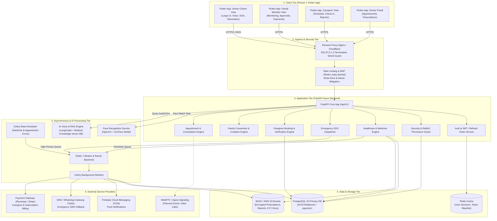
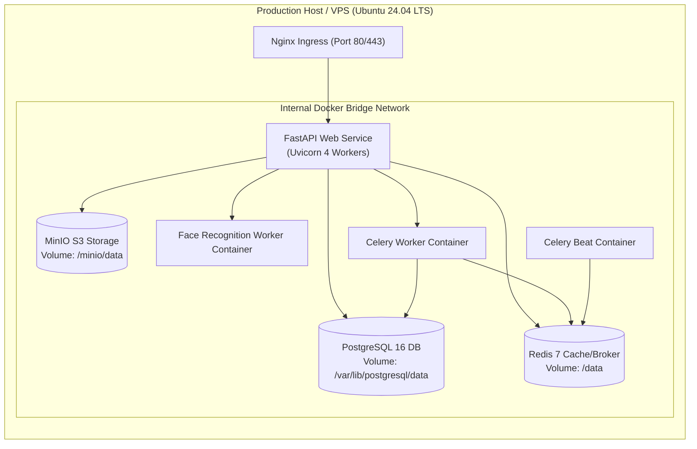

# SeniorCare – Backend Architecture Design Document
**Phase 1 Deliverable | Role: Person 2 (Backend Architect & Database Designer)**
**Target Platform:** SeniorCare – AI-Powered Elderly Healthcare & Caregiving Platform

---

## 1. Executive Summary & Architecture Philosophy

SeniorCare is engineered to support vulnerable senior citizens, their remote family members, professional caregivers, and healthcare providers. The backend architecture is designed around four foundational pillars:

1. **High Resilience & Fault Tolerance:** Elderly health monitoring and Emergency SOS dispatch cannot fail under load or network instability.
2. **Strict Relationship-Based Security (ReBAC + RBAC):** Medical vitals, prescriptions, and live locations are confidential. Family members only access what the senior has explicitly authorized.
3. **Low-Latency & Asynchronous Processing:** Heavy tasks (face recognition, AI voice transcription, push notification dispatch, automated medicine reminder schedules) are offloaded to asynchronous background workers.
4. **Clean Decoupling:** The architecture allows Person 1's Flutter frontend to interact with a unified, versioned REST API (`/api/v1`) while modular micro-services or worker tasks handle compute-heavy operations.

---

## 2. Technology Stack Selection & Rationale

| Layer / Component | Technology | Rationale |
| :--- | :--- | :--- |
| **Language & Runtime** | Python 3.11+ | Native ecosystem for AI/ML (OpenCV, PyTorch, LangGraph, RAG) and robust async I/O. |
| **API Framework** | FastAPI (ASGI / Uvicorn) | High-performance asynchronous REST API, automatic OpenAPI schema generation, strict type safety via Pydantic v2. |
| **Database** | PostgreSQL 16+ with `pgvector` | Robust ACID compliance for medical & billing records, JSONB support for flexible medical payloads, vector indexing for RAG. |
| **ORM & Migrations** | SQLAlchemy 2.0 (Async) & Alembic | Clean declarative mapping, async execution (`asyncpg`), reliable schema migration history. |
| **In-Memory Cache & Broker** | Redis 7 | Sub-millisecond session caching, distributed rate-limiting, and high-throughput task queue broker for Celery. |
| **Background Processing** | Celery & Celery Beat | Scheduled reminder dispatch (medicine doses), automated health report generation, SMS/push retries. |
| **Biometric Vision Service** | OpenCV + ArcFace / FaceNet | Robust face detection, alignment, liveness verification, and 512-D embedding extraction for senior authentication. |
| **AI Assistant & RAG** | LangGraph + LangChain + Ollama/OpenAI | Stateful conversational agent for senior voice queries, contextual retrieval over validated medical FAQs. |
| **Push Notifications** | Firebase Cloud Messaging (FCM) | Cross-platform (Android/iOS) instant notification delivery for medicine alerts and emergency SOS. |
| **Object Storage** | MinIO / AWS S3 (Encrypted SSE-S3) | Secure, private storage for medical scans, prescription PDFs, caregiver verification IDs, and visit photos. |
| **Containerization** | Docker & Docker Compose | Multi-container reproducible environments across local development, staging, and production. |

---

## 3. High-Level System Architecture Diagram

---

## 4. Subsystem Deep-Dive

### 4.1 FastAPI Application Tier & Request Lifecycle
1. **Request Intake:** All HTTP/JSON and multipart requests arrive through the reverse proxy with TLS 1.3 encryption.
2. **Pydantic Validation:** Inbound JSON payloads are parsed and validated by strict Pydantic v2 request schemas before reaching route handlers.
3. **Authentication & Identity Resolution:** 
   - Public routes (Login, Register, Refresh) do not require Bearer tokens.
   - Protected routes extract the `Authorization: Bearer <JWT>` header.
   - The token signature, expiry, and revocation status (checked in Redis blacklist) are validated.
4. **ReBAC (Relationship-Based Access Control) Enforcement:**
   - If a family member requests `GET /api/v1/healthcare/seniors/{senior_id}/medicines`, the ReBAC dependency checks the `family_relationships` and `access_permissions` tables to ensure the senior granted `medicines:view` to this specific family user.
5. **Database Interaction:** Handled asynchronously using SQLAlchemy 2.0 with session lifecycle dependency injection (`get_db_session`).
6. **Background Task Delegation:** Time-consuming operations (e.g., dispatching 5 SMS messages, sending FCM pushes, writing audit trails) are delegated to Celery via Redis broker.

### 4.2 Face Recognition Architecture (OpenCV + ArcFace)
- **Role in Platform:** Offers a passwordless, senior-friendly authentication flow tailored for elderly users who may struggle with complex alphanumeric passwords.
- **Processing Isolation:** Face verification is encapsulated in an internal service/worker to avoid blocking FastAPI's async event loop.
- **Workflow:**
  1. Frontend captures 3 frames during registration with blink/liveness prompt.
  2. OpenCV detects face boundaries, evaluates image sharpness, checks facial landmark alignment, and verifies liveness.
  3. ArcFace computes a 512-dimensional normalized float embedding vector.
  4. The embedding is encrypted using **AES-256-GCM** with a system-managed key before storing in PostgreSQL. The raw face image is permanently discarded.
  5. During login, a new frame is captured, verified for liveness, transformed into an embedding, and matched via Cosine Similarity against the decrypted registered embedding.

### 4.3 AI Voice Assistant & RAG Engine (LangGraph + Medical Knowledge Base)
- **Role in Platform:** Backs the "Ask Me Anything" voice assistant card on Person 1's Home Dashboard.
- **Workflow:**
  1. Senior speaks into Flutter app -> Audio converted to text via local/cloud STT.
  2. Query sent to `POST /api/v1/assistant/chat`.
  3. **LangGraph Agent Workflow:**
     - State includes senior context: name, current medicines, known conditions, emergency contact names.
     - Medical queries trigger RAG retrieval from a vetted elderly healthcare FAQ vector index stored in `pgvector`.
     - Intent classifier detects emergency phrases (e.g., *"I have severe chest pain"*, *"I fell down"*).
     - If emergency intent is detected, LangGraph invokes the `trigger_emergency_sos` tool automatically.
     - Safe, elderly-friendly conversational response is synthesized into Hindi/English and returned as text and TTS audio url.

### 4.4 Emergency SOS Dispatcher Subsystem
- **Role in Platform:** Powering the prominent SOS Card on Person 1's Dashboard.
- **Critical Path:** Must guarantee delivery within $< 3$ seconds.
- **Execution Flow:**
  1. Senior taps SOS card -> Flutter captures GPS coordinates -> `POST /api/v1/emergency/sos`.
  2. FastAPI creates an active `sos_events` record immediately with status `ACTIVE`.
  3. An urgent Celery task is pushed to the `critical` queue.
  4. Worker parallelizes:
     - High-priority FCM push with custom emergency sound and full-screen notification to all connected family members.
     - Twilio SMS / WhatsApp alert with senior name, timestamp, and Google Maps live location link to primary emergency contacts.
     - Webhook alert to registered nearby partner hospital/ambulance service.
  5. Real-time updates streamed back to family members via WebSocket (`/ws/emergency/{event_id}`).

### 4.5 Healthcare & Medicine Reminder Subsystem
- **Role in Platform:** Supporting "My Medicines", "Health Tracker", and the "Reminders" tab.
- **Cron Scheduling:** Celery Beat wakes up every minute, queries upcoming doses in `medicine_schedules`, and queues push notifications for seniors whose scheduled time is within the next 15 minutes.
- **Adherence Tracking:** Senior taps "Taken" or "Snooze" in the app -> triggers `POST /api/v1/healthcare/medicines/logs`. If a critical medicine remains unacknowledged after 45 minutes, an automated notification is escalated to the linked family member.

---

## 5. Phased Service Architecture (Initial MVP vs. Future Phases)

To ensure rapid, reliable delivery without architectural debt, services are classified by phase:

| Subsystem / Service | Phase 1 (Architecture & Skeleton) | Phase 2 (Core MVP Implementation) | Phases 3–7 (Full Platform Rollout) |
| :--- | :---: | :---: | :---: |
| **FastAPI REST Skeleton & Core Config** | **Ready (This Phase)** | Active API endpoints | Expanded routing & microservices |
| **PostgreSQL Schema & Migrations** | **Ready (This Phase)** | Populated & Tested | Sharding & Read Replicas |
| **Argon2id & JWT Auth Engine** | **Ready (This Phase)** | Complete Auth flow | Biometric Multi-Factor Auth |
| **ReBAC Relationship Permission Engine**| **Ready (This Phase)** | Family Access Enforcement | Granular Doctor/Nurse Delegations |
| **Face Recognition Engine** | Blueprint & Schema Ready | OpenCV + ArcFace Pipeline | Edge-based On-Device Liveness |
| **Emergency SOS Engine** | Blueprint & Schema Ready | High-Priority Celery + FCM | Automated Call Bot & Geofencing |
| **Medicine Schedule & Reminders** | Blueprint & Schema Ready | Celery Beat & Logging | Smart Pill Box Hardware IoT Hook |
| **Caregiver Booking Engine** | Blueprint & Schema Ready | Booking CRUD & Status Track | Real-Time GPS Tracking & Check-in |
| **AI Assistant (LangGraph RAG)** | Blueprint & Schema Ready | Contextual Chat via Text | Full Duplex Voice Streaming |
| **Doctor Telehealth (WebRTC)** | Architectural Hook | Mock Consultation Link | Native In-App WebRTC Video Room |
| **Payment Gateway Integration** | Architectural Hook | Test Gateway Integration | Automated Caregiver Escrow Payouts |

---

## 6. Deployment & Infrastructure Strategy

SeniorCare backend is containerized for seamless orchestration using **Docker Compose** (for local/staging) and **Kubernetes** (for production scaling):

This modular architecture guarantees that Person 1's frontend can consume clean REST endpoints right from Phase 2 while the backend handles security, data integrity, and high-load background tasks effortlessly.

