# SeniorCare – Entity Relationship (ER) Diagram
**Phase 1 Deliverable | Role: Person 2 (Database Designer & API Architect)**

---

## 1. Relational Architecture Overview

The SeniorCare database schema features **37 core tables** partitioned into 11 cohesive domain modules. The ER diagram below illustrates the relational connections, primary keys (`PK`), foreign keys (`FK`), and cardinalities between users, seniors, family members, healthcare entities, caregivers, and emergency systems.

---

## 2. Mermaid Entity Relationship Diagram

```mermaid
erDiagram
    %% MODULE A: USERS & PROFILES
    users ||--o| senior_profiles : "has profile"
    users ||--o| family_profiles : "has profile"
    users ||--o| caregiver_profiles : "has profile"
    users ||--o| doctor_profiles : "has profile"
    users ||--o{ devices : "registers"
    users ||--o{ refresh_tokens : "holds"
    users ||--o{ login_sessions : "logs"
    users ||--o| face_profiles : "authenticates via"

    %% MODULE B: FAMILY CONNECTIONS & REBAC
    senior_profiles ||--o{ family_relationships : "connects to"
    users ||--o{ family_relationships : "acts as family member in"
    senior_profiles ||--o{ family_invitations : "invites from"
    family_relationships ||--o{ access_permissions : "delegates"

    %% MODULE D: HEALTHCARE & MEDICINES
    senior_profiles ||--o{ health_records : "owns"
    senior_profiles ||--o{ prescriptions : "receives"
    doctor_profiles ||--o{ prescriptions : "prescribes"
    prescriptions ||--o{ medicines : "contains"
    senior_profiles ||--o{ medicines : "takes"
    medicines ||--o{ medicine_schedules : "scheduled at"
    medicine_schedules ||--o{ medicine_logs : "adherence recorded in"

    %% MODULE E: CAREGIVER SERVICES & BOOKINGS
    caregiver_profiles ||--o{ caregiver_qualifications : "holds"
    caregiver_profiles ||--o{ caregiver_verification_documents : "verifies with"
    caregiver_profiles ||--o{ caregiver_availability : "sets availability"
    senior_profiles ||--o{ bookings : "receives service"
    caregiver_profiles ||--o{ bookings : "delivers care"
    services ||--o{ bookings : "service category"
    bookings ||--o{ booking_status_history : "tracks lifecycle"
    bookings ||--o{ caregiver_visit_reports : "documents shift"

    %% MODULE F: MEDICAL APPOINTMENTS & LABS
    senior_profiles ||--o{ doctor_appointments : "attends"
    doctor_profiles ||--o{ doctor_appointments : "consults"
    senior_profiles ||--o{ lab_bookings : "tests booked for"

    %% MODULE G: EMERGENCY SOS
    senior_profiles ||--o{ emergency_contacts : "notifies"
    senior_profiles ||--o{ sos_events : "triggers"

    %% MODULE H: FAMILY UPDATES
    senior_profiles ||--o{ family_updates : "receives moments"
    users ||--o{ family_updates : "posts update"
    family_updates ||--o{ update_attachments : "attaches photos"

    %% MODULE I: PAYMENTS & SUBSCRIPTIONS
    subscription_plans ||--o{ subscriptions : "subscribed under"
    users ||--o{ subscriptions : "purchases"
    users ||--o{ payments : "executes"
    bookings ||--o{ payments : "settles"

    %% MODULE J: NOTIFICATIONS & PREFERENCES
    users ||--o{ notifications : "receives"
    users ||--o| notification_preferences : "configures"

    %% MODULE K: REVIEWS & AUDIT
    users ||--o{ reviews : "authors"
    users ||--o{ audit_logs : "audited under"

    %% DETAILED ENTITY DEFINITIONS
    users {
        UUID id PK
        VARCHAR phone_number UK
        VARCHAR email UK
        VARCHAR hashed_password
        VARCHAR role
        BOOLEAN is_active
        BOOLEAN is_verified
        TIMESTAMPTZ created_at
    }

    senior_profiles {
        UUID id PK
        UUID user_id FK
        VARCHAR full_name
        VARCHAR preferred_name
        DATE date_of_birth
        VARCHAR blood_group
        TEXT address
        DECIMAL latitude
        DECIMAL longitude
        VARCHAR primary_language
        TEXT emergency_notes
    }

    family_relationships {
        UUID id PK
        UUID senior_id FK
        UUID family_user_id FK
        VARCHAR relation_type
        BOOLEAN is_emergency_contact
        VARCHAR status
        TIMESTAMPTZ created_at
    }

    access_permissions {
        UUID id PK
        UUID relationship_id FK
        VARCHAR permission_module
        VARCHAR access_level
        TIMESTAMPTZ granted_at
    }

    face_profiles {
        UUID id PK
        UUID user_id FK
        BYTEA encrypted_embedding
        BYTEA encryption_iv
        BYTEA encryption_tag
        VARCHAR model_version
        DECIMAL quality_score
        BOOLEAN is_active
    }

    health_records {
        UUID id PK
        UUID senior_id FK
        VARCHAR title
        VARCHAR record_type
        TIMESTAMPTZ recorded_at
        UUID recorded_by_user_id FK
        INTEGER vital_bp_systolic
        INTEGER vital_bp_diastolic
        DECIMAL vital_blood_glucose
        VARCHAR document_s3_key
    }

    medicines {
        UUID id PK
        UUID senior_id FK
        UUID prescription_id FK
        VARCHAR name
        VARCHAR dosage_strength
        VARCHAR form
        VARCHAR meal_relation
        BOOLEAN is_active
    }

    medicine_schedules {
        UUID id PK
        UUID medicine_id FK
        TIME time_of_day
        DECIMAL dose_quantity
    }

    medicine_logs {
        UUID id PK
        UUID schedule_id FK
        UUID senior_id FK
        TIMESTAMPTZ scheduled_timestamp
        VARCHAR status
        TIMESTAMPTZ logged_at
    }

    bookings {
        UUID id PK
        UUID senior_id FK
        UUID booked_by_user_id FK
        UUID caregiver_id FK
        UUID service_id FK
        TIMESTAMPTZ start_datetime
        TIMESTAMPTZ end_datetime
        DECIMAL total_amount
        VARCHAR payment_status
        VARCHAR status
    }

    sos_events {
        UUID id PK
        UUID senior_id FK
        TIMESTAMPTZ triggered_at
        VARCHAR trigger_source
        DECIMAL latitude
        DECIMAL longitude
        VARCHAR status
        TIMESTAMPTZ resolved_at
    }
```

---

## 3. Structural Highlights & Key Cardinalities

1. **Seniors $\leftrightarrow$ Family Members (Many-to-Many):**
   - A single senior profile can connect to multiple family users (`family_relationships`).
   - A family user can care for multiple seniors (e.g., father, mother, in-laws) under one login.
   - For every connection, a granular child row in `access_permissions` governs module-level visibility (e.g., Daughter has `full_management` of medicines; Cousin has `view_only` of health summary).

2. **Medicine Schedules $\leftrightarrow$ Real-Time Adherence Tracking:**
   - Every medicine has one or more `medicine_schedules` (e.g., 08:00 AM, 02:00 PM, 08:00 PM).
   - When a scheduled dose occurs, the system logs an entry in `medicine_logs`. Adherence percentages and missed alerts are computed off this table.

3. **Caregiver Lifecycle Isolation:**
   - The caregiver booking pipeline transitions across `requested` $\rightarrow$ `confirmed` $\rightarrow$ `in_progress` $\rightarrow$ `completed`.
   - Every transition is immutably logged in `booking_status_history`.
   - On completion of a visit, a `caregiver_visit_reports` record records checked vitals, notes, and photos, visible to the family member who commissioned the service.

4. **Biometric Security Decoupling:**
   - The `face_profiles` table isolates biometric embeddings from general user records. Embeddings are stored encrypted with AES-256-GCM. The primary table contains no identifiable raw image assets.

