# SeniorCare – Biometric Face Recognition Architecture & Security Specification
**Phase 1 Deliverable | Role: Person 2 (Security Architect & Machine Learning Engineer)**
**Technology Stack:** OpenCV 4.10+ (Face Detection & Liveness) + ArcFace / ResNet-50 (Deep Feature Extraction) + AES-256-GCM Cryptographic Storage

---

## 1. Executive Summary & Senior-Centric Design Principles

For elderly citizens—many of whom have visual impairments, tremors, or difficulty remembering complex passwords—**biometric face authentication** provides a compassionate, frictionless gateway into the SeniorCare app.

However, biometrics cannot be changed if compromised. Therefore, the SeniorCare face recognition pipeline is engineered around strict defense-in-depth principles:
1. **OpenCV is strictly for computer vision preprocessing:** OpenCV handles frame decoding, face localization, landmark alignment, illumination normalization, and initial liveness cues. It does **not** perform identity verification on its own.
2. **Deep Metric Embedding via ArcFace (Additive Angular Margin Loss):** A deep ResNet-50 neural network maps facial features into a compact, highly discriminative 512-dimensional hypersphere vector where intra-class distance is minimized and inter-class distance is maximized.
3. **Zero Raw Image Storage Policy:** Raw face images are processed in memory and **never written to disk or database tables**. Once the 512-D embedding is extracted, image bytes are zeroed out in memory.
4. **Hardware-Enforced AES-256-GCM Encryption:** Biometric embeddings in PostgreSQL (`face_profiles`) are stored as encrypted byte arrays protected by AES-256 in Galois/Counter Mode with per-user unique Initialization Vectors (IV) and authentication tags.

---

## 2. End-to-End Architectural Pipeline

```mermaid
flowchart TD
    subgraph Client ["Client Device (Flutter Frontend)"]
        CamCapture["Camera Stream Capture\n(3 Frames during Registration)"]
        ClientGuide["Interactive Visual Guidance\n('Please look straight & blink')"]
        ClientEncrypt["TLS 1.3 Transport Encryption"]
    end

    subgraph Preprocessing ["OpenCV Vision Pipeline (Worker / Service)"]
        DecodeFrame["OpenCV cv2.imdecode()\n(Convert to BGR numpy array)"]
        HaarOrDNN["Face Detection (OpenCV DNN / YuNet)\nBounding Box & Landmark Extraction"]
        Alignment["Affine Transformation & Landmark Alignment\n(Eye centers aligned horizontally)"]
        QualityCheck["Image Quality Assurance\n(Laplacian Blur Variance > 100, Min 160x160 px)"]
        LivenessCheck["Anti-Spoofing & Liveness Engine\n(Blink Frequency + Frequency Domain FFT Texture)"]
    end

    subgraph DeepLearning ["ArcFace Deep Feature Engine"]
        Normalize["Standardization (Mean 127.5, Scale 1/128)"]
        ArcFaceModel["ArcFace ResNet-50 ONNX Runtime\nInference: 512-Dimensional Float Vector"]
        L2Norm["L2-Normalization (Vector Norm = 1.0)"]
    end

    subgraph CryptoStorage ["Cryptographic Storage Engine"]
        AESEncrypt["AES-256-GCM Encryption\nKey derived from Master HSM Key + User Salt"]
        StoreDB[("PostgreSQL face_profiles Table\n(encrypted_embedding, iv, tag)")]
    end

    %% Flow connections
    CamCapture --> ClientGuide
    ClientGuide --> ClientEncrypt
    ClientEncrypt --> DecodeFrame
    DecodeFrame --> HaarOrDNN
    HaarOrDNN --> Alignment
    Alignment --> QualityCheck
    QualityCheck --> LivenessCheck
    LivenessCheck --> Normalize
    Normalize --> ArcFaceModel
    ArcFaceModel --> L2Norm
    L2Norm --> AESEncrypt
    AESEncrypt --> StoreDB
```

---

## 3. Detailed Workflows

### 3.1 Face Enrollment Workflow (Registration)
1. **Interactive Senior UI:** The Flutter app prompts the senior: *"कृपया कैमरे की ओर देखें और एक बार पलकें झपकाएं"* (Please look at the camera and blink once).
2. **Multi-Frame Capture:** The app records 3 sequential frames (Frontal Neutral, Blink Frame, Slight Tilt) within 2 seconds.
3. **OpenCV Preprocessing:**
   - **Detection:** `cv2.dnn.readNetFromONNX("yunet.onnx")` detects facial boundaries and 5 primary landmarks (left eye, right eye, nose tip, left mouth corner, right mouth corner).
   - **Quality Validation:**
     - Head pose angles: $\text{Yaw} < 15^\circ$, $\text{Pitch} < 15^\circ$, $\text{Roll} < 10^\circ$.
     - Illumination: Mean pixel intensity between $50$ and $210$ (avoids underexposed shadows or washouts).
     - Sharpness: `cv2.Laplacian(gray, cv2.CV_64F).var() > 100` (rejects motion blur).
4. **Anti-Spoofing Verification:** Eye Aspect Ratio (EAR) validates genuine eyelid closure during the blink frame to defeat static 2D paper photograph spoofing.
5. **Feature Extraction:** ArcFace generates three 512-D float vectors. The vectors are averaged and L2-normalized:
   $$\vec{e}_{\text{enrolled}} = \frac{\sum_{i=1}^{3} \vec{e}_i}{\|\sum_{i=1}^{3} \vec{e}_i\|_2}$$
6. **Encrypted Storage:**
   - Vector serialized to 2048 raw bytes ($512 \times 4\text{ bytes float32}$).
   - Encrypted with AES-256-GCM using a server-side encryption key derived with HKDF.
   - Inserted into `face_profiles` along with random 12-byte IV and 16-byte authentication tag.

---

### 3.2 Face Verification Workflow (Login)
1. **Live Capture:** Senior opens the app, taps "Face Login", and looks into the front-facing camera.
2. **Single Live Frame & Motion Check:** Frame sent over TLS to `POST /api/v1/auth/face/verify-login`.
3. **OpenCV Alignment & Liveness:** Validated for sharpness and natural texture characteristics (Moiré pattern detection to prevent mobile screen replay attacks).
4. **Inference:** ArcFace extracts live vector $\vec{e}_{\text{live}}$.
5. **Decryption & Matching:**
   - Server loads encrypted embedding for the user phone number from `face_profiles`.
   - Decrypts and authenticates GCM ciphertext in memory.
   - Computes **Cosine Similarity**:
     $$\text{Cosine Similarity} = \vec{e}_{\text{live}} \cdot \vec{e}_{\text{enrolled}} = \sum_{j=1}^{512} e_{\text{live}, j} \cdot e_{\text{enrolled}, j}$$
6. **Decision Logic:**
   - If $\text{Similarity} \ge 0.68$: **Match Confirmed**. Issue JWT access and refresh tokens.
   - If $0.58 \le \text{Similarity} < 0.68$: **Borderline**. Request a second blink snapshot.
   - If $\text{Similarity} < 0.58$: **Verification Failed**. Increment failed attempt counter.

---

## 4. Anti-Spoofing & Liveness Detection Architecture

Elderly individuals are frequent targets of impersonation attacks. SeniorCare deploys a dual-tier liveness defense:

### 4.1 Passive Liveness (Texture & Frequency Analysis via OpenCV)
* **High-Frequency Analysis (Fourier Transform):** Digital screens and printed paper display telltale micro-texture grids (Moiré patterns). Applying 2D Fast Fourier Transform (`cv2.dft()`) highlights anomalous high-frequency peaks characteristic of fake mediums.
* **Color Distortion Analysis:** Real human skin displays subtle subsurface light scattering that photos on LCD screens lack. OpenCV analyzes the HSV and YCrCb color channels to ensure authentic chromatic distribution.

### 4.2 Active Liveness (Challenge-Response)
* **Blink Detection via Eye Aspect Ratio (EAR):**
  $$\text{EAR} = \frac{\|p_2 - p_6\| + \|p_3 - p_5\|}{2 \|p_1 - p_4\|}$$
  When eyes are open, $\text{EAR} \approx 0.32$. When blinking, $\text{EAR}$ drops below $0.18$.
* **Random Challenge Prompts:** If an attempt seems borderline, the app prompts: *"Please smile"* or *"Turn your head slightly to the right"*. OpenCV landmark trackers verify directional movement before approving.

---

## 5. Security Thresholds, Lockouts & Fallback Mechanisms

| Parameter | Configured Value | Engineering Rationale |
| :--- | :--- | :--- |
| **Verification Match Threshold** | **$0.68$ (Cosine Similarity)** | Calibrated on LFW and AgeDB datasets for False Acceptance Rate (FAR) $< 0.001\%$ and False Rejection Rate (FRR) $< 1.2\%$. |
| **Max Consecutive Failures** | **3 Attempts** | Prevents automated dictionary attacks. |
| **Lockout Duration** | **15 Minutes** | Temporary cooling-off period after 3 failed attempts. |
| **Emergency Fallback** | **6-digit SMS OTP or PIN** | Senior can immediately click *"Login with SMS OTP"* if lighting is poor or face recognition fails. |
| **Family Alert Trigger** | **Enabled** | If 3 consecutive face login failures occur on a senior's account, an alert notification is dispatched to their linked primary family member. |

---

## 6. Privacy Compliance & Biometric Consent (DPDP Act 2023 & GDPR)

1. **Informed Consent Screen:** Before the camera opens for the first time, an explicit, high-contrast consent dialogue explains in simple vernacular language:
   - *"We use your camera only to recognize your face so you do not have to type passwords."*
   - *"Your actual photos are never stored. Only a secure digital code is kept."*
2. **Right to Revoke & Verifiable Deletion:**
   - The senior or their guardian can navigate to Settings $\rightarrow$ Biometric Security $\rightarrow$ **"Delete Face Data"**.
   - Invoking `DELETE /api/v1/auth/face/profile` executes an immediate `DELETE FROM face_profiles WHERE user_id = :id`.
   - The user account reverts automatically to password/OTP authentication without penalty.
3. **No Third-Party Sharing:** Biometric data is strictly confined to internal encrypted servers and is never shared with third-party analytics, advertisers, or insurance partners.

