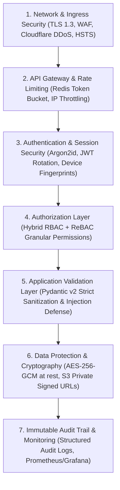
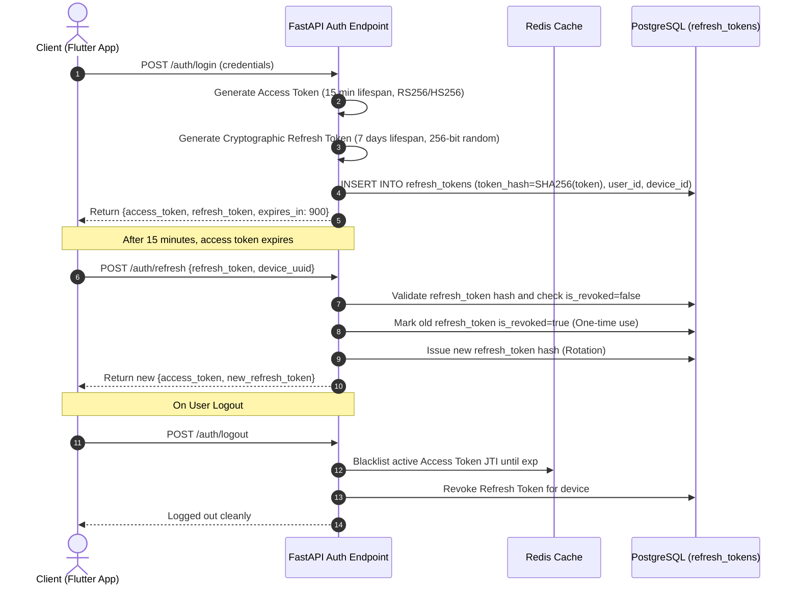
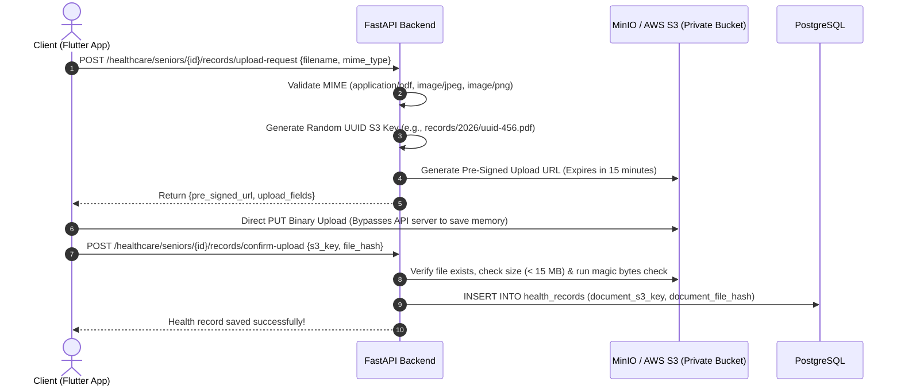

# SeniorCare – Comprehensive Security Architecture & Compliance Plan
**Phase 1 Deliverable | Role: Person 2 (Security Architect & Compliance Lead)**
**Compliance Targets:** Digital Personal Data Protection (DPDP) Act 2023, HIPAA Security Rule Guidelines, ISO/IEC 27001

---

## 1. Security Architecture Principles

Elderly healthcare applications carry a uniquely sensitive security profile:
1. **Target Vulnerability:** Senior citizens are disproportionately vulnerable to social engineering, credential theft, and unauthorized financial transactions.
2. **Clinical Confidentiality:** Medical vitals, lab diagnostics, and psychiatric medications are deeply private health data.
3. **Physical Safety Impact:** An erroneous denial of service on an Emergency SOS or an unauthorized medication change could endanger a human life.

Consequently, SeniorCare implements a **Zero-Trust, Defense-in-Depth** security architecture across all seven layers:



---

## 2. Password Hashing via Argon2id

Passwords are never stored in plain text or using obsolete algorithms (MD5, SHA-1, or basic SHA-256). SeniorCare utilizes **Argon2id**—the winner of the Password Hashing Competition (PHC)—configured to resist GPU-based cracking:

```python
# app/core/security.py
from passlib.context import CryptContext

pwd_context = CryptContext(
    schemes=["argon2"],
    argon2__memory_cost=65536,  # 64 MB RAM per hash calculation
    argon2__time_cost=3,        # 3 iterations
    argon2__parallelism=4,      # 4 parallel threads
    deprecated="auto"
)

def hash_password(password: str) -> str:
    return pwd_context.hash(password)

def verify_password(plain_password: str, hashed_password: str) -> bool:
    return pwd_context.verify(plain_password, hashed_password)
```

---

## 3. JWT Token Architecture & Rotation Strategy

SeniorCare uses a decoupled token lifecycle:



* **Short-Lived Access Tokens:** Expire in **15 minutes** to minimize damage from token leakage.
* **Refresh Token Rotation (RTR):** Every time a refresh token is used, it is invalidated immediately, and a new one is issued. If an invalidated refresh token is ever reused, the system detects a token theft event and revokes **all** active sessions for that user.
* **Token Blacklisting in Redis:** Blacklisted tokens are cached in Redis with a TTL matching the token's remaining lifespan.

---

## 4. Relationship-Based Access Control (ReBAC) Implementation

Standard RBAC is supplemented by relationship-aware checks. For every request accessing a senior's records, FastAPI executes:
1. **Direct Ownership Check:** Is `current_user.id` the senior themselves? If yes, allow.
2. **ReBAC Relationship Verification:** Is there an active row in `family_relationships` for `(senior_id, current_user.id)`?
3. **Module Permission Check:** Does `access_permissions` contain the target module (e.g., `medicines`) with appropriate level (`view_only` or `full_management`)?
4. **Caregiver Shift Bound Check:** If `current_user.role == 'caregiver'`, is there a booking with status `confirmed` or `in_progress` scheduled for **today**? Caregivers cannot browse senior medical histories outside active bookings.

---

## 5. Medical Records & Private File Storage Architecture

Medical documents (prescriptions, diagnostic blood tests, MRI scans, caregiver KYC documents) are stored in an S3-compatible private object store (MinIO / AWS S3) with the following safeguards:



* **Zero Public S3 Buckets:** The bucket is completely private; public read access is disabled at the policy level.
* **Pre-Signed Expiring Download URLs:** When a family member or doctor opens a prescription, the backend generates an HMAC-signed S3 URL that expires in **5 minutes**.
* **Server-Side Encryption:** Objects are encrypted at rest using AES-256 (`SSE-S3` or `SSE-KMS`).

---

## 6. Input Validation & Injection Mitigation

All incoming request payloads are validated using **Pydantic v2**:
* **Strict Type Enforcement:** Eliminates type-juggling attacks.
* **Regex Sanitization:** Phone numbers, dates, and postal codes are strictly validated.
* **SQL Injection Immunity:** Handled automatically by SQLAlchemy 2.0 parameterized queries. Raw string concatenations in SQL queries are strictly prohibited.
* **XSS Defense:** Free-form notes and descriptions are HTML-escaped before persistence.

---

## 7. Distributed Rate Limiting (Redis Token Bucket)

To prevent brute-force attacks on OTP endpoints, credential spraying, and denial-of-service on emergency endpoints:

| Endpoint Route | Rate Limit Bucket | Action on Violation |
| :--- | :--- | :--- |
| `POST /auth/login` | 5 requests / minute per IP | 429 Too Many Requests + 5 min ban |
| `POST /auth/register/senior` (OTP dispatch)| 3 requests / 15 minutes per phone | Prevents SMS abuse |
| `POST /auth/face/verify-login` | 5 requests / 5 minutes per user | Temporary fallback to OTP |
| `POST /emergency/sos` | 10 requests / 5 minutes per senior | High threshold to prevent false lockout |
| General API Routes | 120 requests / minute per Bearer token | Graceful throttling |

---

## 8. Immutable Audit Logging

Every security-sensitive event is recorded in the `audit_logs` table:
* Who performed the action (`actor_user_id`).
* What entity was affected (`target_entity_type`, `target_entity_id`).
* Exactly what occurred (`CREATE`, `READ`, `UPDATE`, `REVOKE`, `DELETE`).
* Contextual snapshot (`ip_address`, `details_json`).
* Audit records are append-only; `UPDATE` and `DELETE` queries are disabled on this table via PostgreSQL database triggers.

---

## 9. Special Protections for Elderly Users

1. **Elder Financial Abuse Prevention:**
   - Caregivers **cannot** initiate payments or modify subscription plans.
   - Any transaction exceeding ₹5,000 requires two-factor authorization from the senior's designated primary family member.
2. **Anti-Caregiver Poaching & Identity Theft:**
   - Caregiver profiles remain hidden until police clearance and government ID documents are verified by an administrator.
3. **Accidental SOS Mitigation:**
   - Person 1's UI provides a 5-second cancel countdown with audible haptic feedback before external SMS dispatches fire, preventing unnecessary panic for family members while ensuring absolute speed during true crises.

