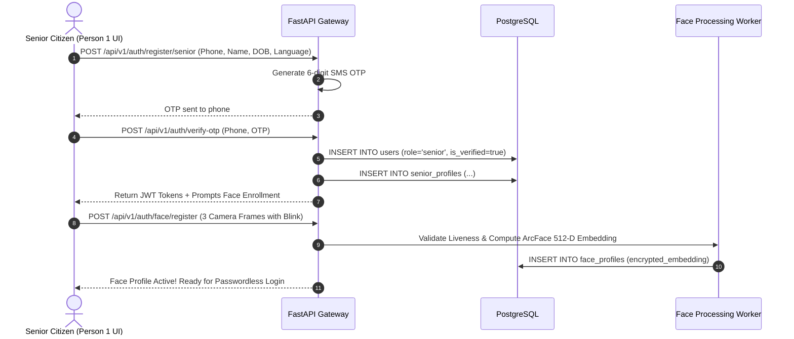
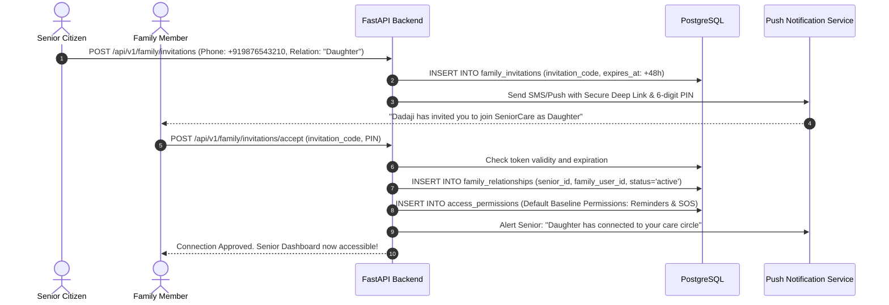

# SeniorCare – User Relationships, Roles & Permissions Blueprint
**Phase 1 Deliverable | Role: Person 2 (Security Architect & API Designer)**
**Security Model:** Hybrid Role-Based Access Control (RBAC) + Relationship-Based Access Control (ReBAC)

---

## 1. Security Architecture Philosophy: RBAC + ReBAC

In a standard enterprise app, Role-Based Access Control (RBAC) is sufficient (e.g., an "Admin" can do everything, a "User" can view their own profile). 

However, in SeniorCare, **healthcare privacy requires Relationship-Based Access Control (ReBAC)**:
1. Having the role `family` does **not** grant access to any senior's medical records by default.
2. A family member must have an active, verified record in `family_relationships` connecting them to a specific senior.
3. Even within an active relationship, access is partitioned into **fine-grained modules** (`health_records`, `medicines`, `live_location`, `caregiver_bookings`, `doctor_consultations`, `financial_billing`).
4. A senior who values autonomy may grant a child permission to book caregivers and receive SOS alerts, while withholding access to psychiatric prescriptions or confidential consultations.
5. Caregivers and Doctors operate under strictly scoped, time-bound service contracts (`bookings` or `doctor_appointments`).

---

## 2. Core User Roles Definition

| Role Identifier | Primary Persona | System Objectives & Operational Boundaries |
| :--- | :--- | :--- |
| **`senior`** | Senior Citizen (Elderly User) | Primary beneficiary. Interacts via simplified, high-contrast UI, voice assistant, and face login. Retains ultimate legal ownership and consent control over their personal health data. |
| **`family`** | Remote Family Member / Guardian | Adult children, spouse, or relatives. Monitors health, configures reminders, books caregivers, pays subscriptions, and receives real-time emergency SOS alerts. |
| **`caregiver`** | Verified Professional Caregiver | Certified nursing attendant, companion, or home health worker. Reviews assigned shifts, checks in via geolocation, documents activities/vitals, and submits visit reports. |
| **`doctor`** | Licensed Medical Professional | Geriatricians and physicians. Conducts teleconsultations, reviews authorized health records, writes digital prescriptions, and updates medical advice. |
| **`admin`** | Platform Operations & Compliance Officer | Internal staff. Verifies caregiver credentials and police clearances, handles billing disputes, inspects audit logs, and maintains service availability. |

---

## 3. End-to-End User Relationship Lifecycles

### 3.1 Senior Citizen Registration Flow


---

### 3.2 Family Member Registration & Cross-Connection Flow
A single family member can care for multiple seniors (e.g., both parents and an elderly aunt):
1. **Family Registration:** Relative downloads app, registers with email/phone and password, selects role `family`. Profile created in `family_profiles`.
2. **Multi-Senior Switcher:** In Person 1's UI, the family member can link to Senior A and Senior B. Their home screen displays an active senior switcher dropdown, allowing seamless toggling between dependents.

---

### 3.3 Senior $\rightarrow$ Family Invitation & Approval Workflow
To eliminate phishing or unauthorized family linking, connections follow a zero-trust handshake:



---

### 3.4 Multi-Family Connections to a Single Senior
A senior citizen often has multiple family members involved in their care (e.g., Son in London, Daughter in Mumbai, Neighbor nearby):
- Senior dashboard maintains a **"My Care Circle"** screen.
- Each member has a distinct entry in `family_relationships`.
- **Primary Contact Designation:** Exactly one family member can be marked `is_primary_caregiver_contact = TRUE` for emergency escalation hierarchy.
- **Secondary Contacts:** Other family members receive standard updates and notifications.

---

### 3.5 Granular Permission Delegation & Instant Revocation

#### Permission Modules
Permissions are partitioned into 6 distinct modules:
1. `health_records`: Access to blood pressure, glucose, diagnostic test PDFs, and clinical notes.
2. `medicines`: Access to view medication regimens, dosages, and daily adherence logs.
3. `live_location`: Real-time GPS location sharing and geofence alerts.
4. `caregiver_bookings`: Authority to hire, schedule, and pay for caregivers on the senior's behalf.
5. `doctor_consultations`: Authority to book doctor teleconsultations and view doctor notes.
6. `financial_billing`: Authority to manage subscriptions and payment cards.

#### Levels of Access
* `none`: Module is completely hidden from the family member.
* `view_only`: Family member can read data and receive updates but cannot modify schedules or cancel appointments.
* `full_management`: Family member can add medications, edit schedules, book doctors, and hire caregivers.

#### Modification & Revocation Procedure
- At any time, the senior (or their legally appointed primary guardian) can invoke:
  `PUT /api/v1/family/relationships/{relationship_id}/permissions`
- Changes take effect **immediately**; Redis cache entries for that relationship token are evicted.
- If a family connection is severed via `DELETE /api/v1/family/relationships/{id}`, all permission tokens are deleted, and the family user immediately loses access on their next API request.

---

## 4. Comprehensive Role-Permission Matrix

The following matrix documents the baseline permissions across all 5 user roles. System endpoints enforce these rules along with ReBAC filters.

| Functional Feature / Resource | Senior Citizen (`senior`) | Family Member (`family`) | Caregiver (`caregiver`) | Doctor (`doctor`) | Administrator (`admin`) |
| :--- | :---: | :---: | :---: | :---: | :---: |
| **Authentication & Profile** |
| Register & Login (Password / OTP) | Own Account | Own Account | Own Account | Own Account | Own Account |
| Face Recognition Enrollment | Self Only | N/A | N/A | N/A | Manage System |
| Edit Personal Profile | Self Only | Self Only | Self (Pending approval) | Self (Pending approval) | Full Access |
| **Family Circle & Permissions** |
| Invite Family Member | Self Only | Co-Family (if authorized)| N/A | N/A | System Support |
| Accept Family Invitation | N/A | Self (Matching phone) | N/A | N/A | N/A |
| View Connected Family Circle | Self & Linked | Self & Linked | N/A | N/A | Audit Access |
| Grant / Modify ReBAC Permissions | Self Only | N/A (Read-only view) | N/A | N/A | Emergency Override |
| Revoke Family Connection | Self Only | Self (Disconnect self) | N/A | N/A | Compliance Audit |
| **Healthcare & Medications** |
| View Health Records & Vitals | Self Only | ReBAC Authorized Only | Assigned Shift Only | Booked Consult Only | N/A (HIPAA/DPDP) |
| Add Health Records / Vitals | Self Only | ReBAC `full_management`| During Active Shift | Post-Consultation | N/A |
| View Medicine Schedules | Self Only | ReBAC Authorized Only | Assigned Shift Only | Booked Consult Only | N/A |
| Create / Edit Medicine Schedule | Self Only | ReBAC `full_management`| N/A | Direct Prescription | N/A |
| Mark Medicine as Taken / Missed | Self Only | ReBAC `full_management`| When on Duty | N/A | N/A |
| Upload Prescriptions | Self Only | ReBAC `full_management`| N/A | Self (Issued) | N/A |
| **Caregiver Services** |
| Search & Browse Caregivers | View Catalog | View Catalog | N/A | N/A | Full Catalog |
| Book Caregiver Shift | Self Only | ReBAC Authorized Only | N/A | N/A | Admin Booking |
| Accept / Reject Booking Request | N/A | N/A | Self Only | N/A | System Reassign |
| Check-in / Submit Visit Report | N/A | N/A | Self (Assigned shift) | N/A | Quality Audit |
| View Caregiver Visit Reports | Self Only | ReBAC Authorized Only | Self (Authored shift) | N/A | Full Inspection |
| Submit Verification Documents | N/A | N/A | Self Only | N/A | Verify / Reject |
| **Emergency SOS System** |
| Trigger Emergency SOS | Self Only | N/A | On-duty for Senior | N/A | Test Trigger |
| Receive Real-Time SOS Alerts | Emergency Sound | Instant Push / SMS | On-duty Alert | N/A | Operations Center |
| View Live SOS Location | Self Only | Linked Family Only | Dispatched Escort | Dispatched Ambulance | Ops Map |
| Resolve / Close SOS Incident | Self (PIN confirm)| Primary Contact Only | N/A | Attending Physician | Admin Override |
| **Medical Appointments & Labs** |
| Book Doctor Consultation | Self Only | ReBAC Authorized Only | N/A | N/A | Admin Booking |
| Conduct Video Teleconsultation | Attend (Self) | Join as Companion | N/A | Conduct (Assigned) | N/A |
| Book Diagnostic Home Lab Test | Self Only | ReBAC Authorized Only | N/A | Order for Patient | Partner Dispatch |
| **AI Voice Assistant** |
| Voice Chat ("Ask Me Anything") | Personalized Context | General Platform Help| Care Protocols Help | Medical Guidelines | Audit / Tuning |
| Access Medical RAG Database | Elderly Simple Explanations | Guidance & Tips | Caregiver Manuals | Clinical Standards | Model Prompting |
| **Payments & Subscriptions** |
| View Subscription Plans | View | View & Purchase | N/A | N/A | Manage Plans |
| Pay for Caregiver / Doctor Fees | Authorize | Authorize & Pay | Payout Dashboard | Payout Dashboard | Escrow Release |
| **Platform Administration & Security** |
| View System Audit Logs | N/A | N/A | N/A | N/A | Read-Only Audit |
| Suspend Abusive Users | N/A | N/A | N/A | N/A | Full Execution |

---

## 5. Implementation Guard: ReBAC Enforcement Middleware

In FastAPI, ReBAC is enforced at the dependency layer before the route handler is invoked:

```python
# Conceptual FastAPI Dependency: app/core/permissions.py
async def require_senior_access(
    senior_id: UUID,
    required_module: str,
    required_level: str = "view_only",
    current_user: User = Depends(get_current_active_user),
    db: AsyncSession = Depends(get_db_session)
):
    # Rule 1: Senior accessing their own data is always permitted
    if current_user.role == "senior":
        senior_profile = await get_senior_profile_by_user(db, current_user.id)
        if senior_profile.id == senior_id:
            return True
        raise HTTPException(status_code=403, detail="Access denied to other senior records")

    # Rule 2: Family member must have verified relationship and permission
    if current_user.role == "family":
        rel = await get_family_relationship(db, senior_id=senior_id, family_user_id=current_user.id)
        if not rel or rel.status != "active":
            raise HTTPException(status_code=403, detail="No active family connection with this senior")

        perm = await get_access_permission(db, relationship_id=rel.id, module=required_module)
        if not perm or not check_level_satisfaction(perm.access_level, required_level):
            raise HTTPException(
                status_code=403, 
                detail=f"Senior has not granted '{required_module}' ({required_level}) permission"
            )
        return True

    # Rule 3: Admin role has authorized maintenance access (logged in audit_logs)
    if current_user.role == "admin":
        await log_admin_access(db, admin_id=current_user.id, target_senior_id=senior_id)
        return True

    raise HTTPException(status_code=403, detail="Role unauthorized for this resource")
```

